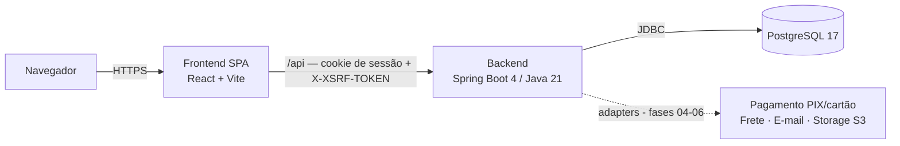

# Arquitetura

## Visão geral



- **Monólito modular** no backend; SPA no frontend. Em desenvolvimento o Vite faz proxy de `/api` para `localhost:8080` (mesma origem). Em produção, recomenda-se um proxy reverso servindo SPA e API no mesmo domínio (cookies `SameSite=Lax` sem CORS); CORS por origem explícita fica disponível para outros cenários.

## Backend (`backend/`)

```
br.com.gigaverse3d
├── BackendApplication
├── common/
│   ├── config/   SecurityConfig (sessão, CSRF SPA, CORS), AppProperties (app.* validado na inicialização)
│   └── web/      StatusController (GET /api/v1/public/status)
└── (fases seguintes) catalog, inventory, account, cart, order, payment, shipping, crm, admin, audit
```

| Aspecto | Decisão |
|---|---|
| Perfis | `dev` (padrão local, Swagger ligado, valores padrão do docker-compose), `test`, `prod` (sem defaults: falha se faltar variável) |
| Banco | Flyway em `src/main/resources/db/migration`; `ddl-auto=validate`; `open-in-view=false` |
| Segurança | Sessão server-side, cookie `HttpOnly`/`SameSite=Lax`/`Secure` (prod), CSRF `csrf.spa()`; rotas não públicas → 401; sem usuário padrão |
| Erros | Sem stack trace, mensagem ou binding errors nas respostas |
| Saúde | `GET /actuator/health` (+ `/liveness`, `/readiness`), sem detalhes; demais endpoints actuator não expostos |
| API | Prefixo `/api/v1`; rotas públicas em `/api/v1/public/**`; OpenAPI em `/swagger-ui.html` somente no perfil `dev` |
| Configuração de loja | `app.store.currency=BRL`, `app.store.payment-methods=PIX,CARD`, `app.store.shipping-origin-postal-code=53625816` |

## Frontend (`frontend/`)

```
src/
├── main.tsx            providers: Theme → React Query → Router
├── App.tsx             rotas + layout da loja (skip link, header, footer)
├── styles/index.css    design tokens (claro/escuro) mapeados para Tailwind
├── theme/              ThemeProvider (data-theme no <html>, persistido em localStorage "gv3d-theme")
├── components/         SiteHeader, SiteFooter, BrandLogo, ThemeToggle, InstagramLink, icons/
├── features/status/    ApiStatus (indicador de conexão, só em dev)
├── lib/                api.ts (fetch com credentials, sem tokens em localStorage), links.ts
└── pages/              HomePage, PlaceholderPage (rotas das próximas fases), NotFoundPage
```

- **Tema:** escuro por padrão; script inline em `index.html` aplica o tema salvo antes da renderização (sem flash). Somente a *preferência de tema* fica no `localStorage`.
- **Marca:** `public/brand/` contém cópia do logo oficial e recortes redimensionados sem distorção (emblema, wordmark, favicon). O original não foi alterado.
- **Referência visual:** `docs/design/referencia-visual-gigaverse3d.png` + especificação das 8 telas.

## Ambiente local

`docker-compose.yml` sobe PostgreSQL 17 com health check, publicado apenas em `127.0.0.1`. Backend e frontend rodam nativamente para ciclo rápido de desenvolvimento; imagens de produção na Fase 12.
