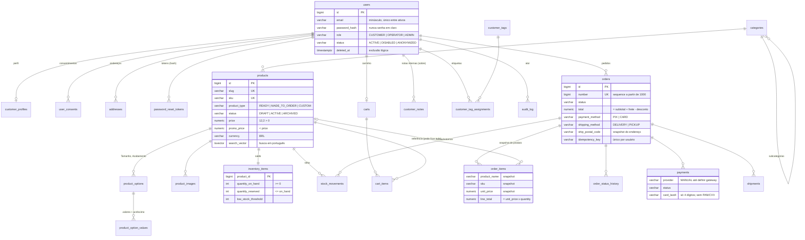
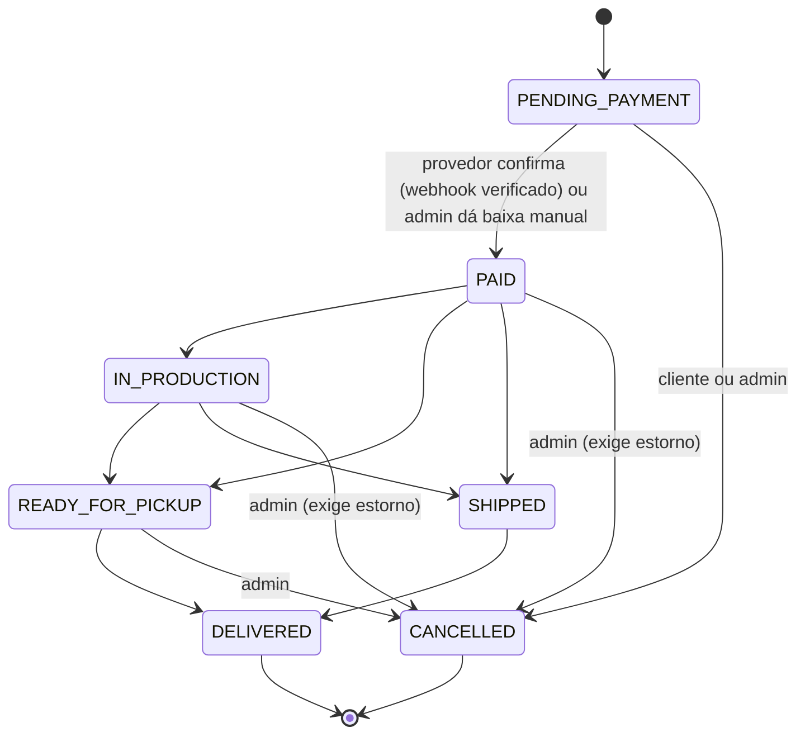

# Modelo de dados

PostgreSQL 17 · migrations Flyway em `backend/src/main/resources/db/migration` (`V1`–`V8`; V7 = carimbo de segurança da sessão, V8 = índices das métricas e do CRM) · Hibernate em modo `validate` (nunca altera o schema).

## Diagrama ER

## Decisões de modelagem

| Tema | Decisão |
|---|---|
| Chaves | `bigint` identity. O cliente vê `orders.number` (sequence ≥ 1000); acesso sempre filtrado pelo dono (`findByNumberAndUserId`). |
| Dinheiro | `numeric(12,2)` + `BigDecimal` (`Money.normalize`, HALF_EVEN). `currency` explícita, restrita a `BRL`. |
| Papéis | Coluna `role` única (`CUSTOMER`, `OPERATOR`, `ADMIN`). Permissões finas por papel ficam no código (Fase 05/09); tabela de permissões só se surgir necessidade real. |
| Snapshots | `order_items` guarda nome, SKU, opções e preço; `orders` guarda nome/e-mail do cliente e endereço. Alterar produto ou cadastro não muda pedidos antigos (testado). |
| Carrinho | Não guarda preço: o servidor recalcula sempre. Carrinho anônimo identificado por hash de token. |
| Estoque | Saldo por produto em `inventory_items` (CHECK ≥ 0, reservado ≤ saldo, `@Version`) + `stock_movements` imutável. Ajuste manual exige motivo. Opções (tamanho/acabamento) são produzidas sob demanda e não têm estoque próprio. |
| Pagamentos | `payments` sem dados sensíveis de cartão (CHECK de formato dos 4 dígitos; PIX não aceita campos de cartão). `payment_webhook_events` garante idempotência de webhooks. Provedor `MANUAL` até a escolha do gateway (D-P01). |
| Busca | Coluna gerada `search_vector` com a configuração `portuguese_unaccent` (V6: extensão `unaccent` + stemmer português) + índice GIN; consultas apenas sobre produtos `ACTIVE`. |
| Exclusão | Produtos: arquivar (`ARCHIVED`) em vez de apagar; `order_items.product_id` vira `NULL` se um produto for removido. Usuários: exclusão lógica/anonimização (`deleted_at`, status `ANONYMIZED`); pedidos impedem exclusão física (`ON DELETE RESTRICT`). Endereços: exclusão lógica. |
| Timestamps | `timestamptz` (UTC), preenchidos pela aplicação (`@PrePersist/@PreUpdate`) e com `DEFAULT now()` no banco. |

## Máquina de estados do pedido

- Implementada em `OrderStatus.allowedNext()`; transições inválidas lançam `InvalidOrderTransitionException`. Toda mudança gera linha em `order_status_history` (quem, quando, motivo).
- O cliente só cancela em `PENDING_PAYMENT`. Itens e valores só mudam antes do pagamento.
- Devolução/troca após `DELIVERED` depende da política comercial (D-P06) — não modelada ainda.
- "Venda" para métricas = pedido em qualquer status pago (`OrderStatus.isPaid()`), conforme proposta D-P12.

## Dados pessoais e retenção (rascunho — validar com responsável legal, Fase 10)

| Dado | Onde | Finalidade | Retenção proposta |
|---|---|---|---|
| Nome, e-mail | `users` | Conta, comunicação do pedido | Enquanto a conta existir; anonimizar a pedido do titular |
| Hash de senha | `users.password_hash` | Autenticação | Até exclusão da conta |
| Telefone | `customer_profiles` (opcional) | Contato sobre entrega | Até exclusão/remoção pelo titular |
| Endereços | `addresses` | Entrega | Até remoção pelo titular (exclusão lógica) |
| Snapshot de pedido (nome, e-mail, endereço) | `orders` | Obrigação fiscal/contábil e defesa em disputas | Prazo legal a definir com contador (tipicamente 5 anos) |
| Consentimentos | `user_consents` | Prova de consentimento (LGPD) | Enquanto houver tratamento baseado nele + prazo prescricional |
| Notas internas | `customer_notes` | Atendimento | Revisar periodicamente; não registrar dados sensíveis |
| Auditoria | `audit_log` | Segurança e rastreabilidade | 1–2 anos (a definir) |

Não coletamos CPF nem data de nascimento nesta versão. Se a emissão de NF-e ou o frete exigirem CPF (D-P11), ele entra como campo próprio com finalidade documentada.

## Dados de demonstração

`db/seed/R__demo_catalog.sql` (migration repetível e idempotente) só é carregado no perfil `dev`, via `spring.flyway.locations`. Contém 5 categorias, 9 produtos (1 rascunho), estoque e opções — **nenhum usuário ou senha**. Os testes confirmam que ele não roda no perfil `test`, e o perfil `prod` não inclui essa pasta.

## Testes

| Suite | O que garante |
|---|---|
| `MigrationIntegrationTest` | V1–V5 aplicam do zero; Hibernate valida o mapeamento; índices essenciais existem; sem coluna de senha em claro; seed ausente fora do `dev` |
| `ConstraintsIntegrationTest` | 21 regras do banco (e-mail minúsculo/único, um endereço principal, preço/promoção, estoque ≥ 0, total consistente, idempotência, cartão só com 4 dígitos, webhook único…) |
| `PersistenceIntegrationTest` | Ida e volta dos agregados, busca textual, snapshot do pedido, filtro por dono, histórico de status |
| `OrderStatusTest` | Transições válidas/inválidas e invariantes do pedido |
| `DevSeedIntegrationTest` | Seed do `dev` carrega o catálogo sem usuários e é idempotente |
